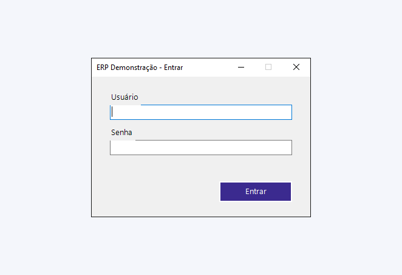
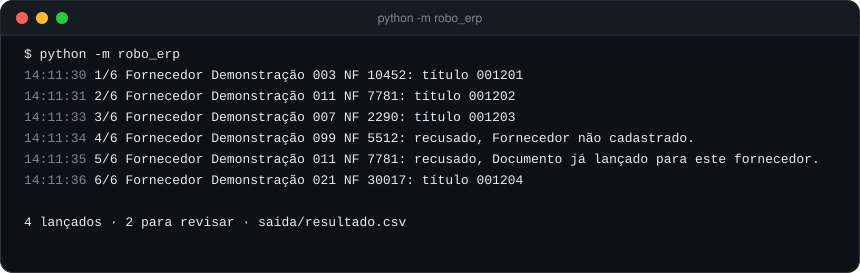

<h1 align="center">Robô de ERP desktop</h1>

<p align="center">
  <b>Automação de sistema desktop pela automação de interface do Windows: o robô acha cada campo pelo nome, preenche,
  salva, lê a resposta do sistema e devolve uma planilha com o resultado de cada linha.</b>
</p>

<p align="center">
  
  
  
  
</p>

---

<p align="center"></p>

## O problema

ERP desktop não tem API para tudo. Lançar dezenas de títulos de uma planilha vira uma tarde de copiar e colar, com erro
de digitação no meio. Automação "por coordenada de tela" quebra na primeira mudança de resolução.

## Como o robô trabalha

- **Acha o campo pelo nome** (AutomationId, via UI Automation), nunca por posição na tela.
- **Escreve pela mensagem do Windows** no controle achado (`WM_SETTEXT`, `BM_CLICK`): instantâneo e funciona até
  com a janela minimizada ou a sessão desconectada.
- **Modo teclado** (`--teclado`): digita tecla por tecla, como uma pessoa, para sistemas que ignoram texto colado
  (comum no campo de senha).
- **Lê a resposta do sistema**: número gravado ou motivo da recusa, que vai para a planilha de resultado.
- **Sai pelo menu**, como uma pessoa; se o menu não responder, fecha a janela. Sempre, mesmo se der erro no meio.
- **Erro de dado não é erro de tela**: recusa do ERP vira `RECUSADO` com o motivo; tela que não responde vira `ERRO`
  com print de evidência.

<p align="center"></p>

## Rodando (Windows)

```powershell
git clone https://github.com/EdyVerder/robo-erp-desktop.git
cd robo-erp-desktop
python -m pip install -r requirements.txt
python -m robo_erp                    # abre o ERP de demonstração e lança dados/titulos_ficticios.csv
python -m pytest -q                   # 5 testes, sem abrir janela nenhuma
```

O "ERP" é um formulário Windows Forms em PowerShell ([`erp_ficticio/erp_demo.ps1`](erp_ficticio/erp_demo.ps1)),
com login, lançamento, validações e menu. O resultado sai em `saida/resultado.csv`.

## Lições que viraram código

- **2 segundos por campo → 0,2.** No Windows Forms, cada escrita pela UI Automation (`SetValue`, `Invoke`) esperava
  2 segundos. Achar pela UI Automation e escrever pela mensagem do Windows derrubou o tempo de um título de
  13 s para cerca de 1 s.
- **Janela minimizada não é "pronta".** A espera padrão do pywinauto exige janela visível; o robô espera "existe e
  está habilitada", que vale para os dois casos.
- **Mesma recusa duas vezes seguidas.** O texto de situação não muda; o robô aceita a mensagem repetida depois de
  um curto intervalo em vez de esperar para sempre.

## Estrutura

```
robo_erp/
  tela.py        o robô na tela: abrir, entrar, lançar, foto, sair
  lote.py        planilha de entrada, laço e planilha de resultado (sem saber de tela)
  __main__.py    linha de comando
erp_ficticio/
  erp_demo.ps1   o ERP de mentira
dados/
  titulos_ficticios.csv
tests/           com um dublê no lugar da tela
```

---

<p align="center"><sub>Feito por <a href="https://github.com/EdyVerder">Rocha</a> · ERP e fornecedores fictícios · licença MIT</sub></p>
